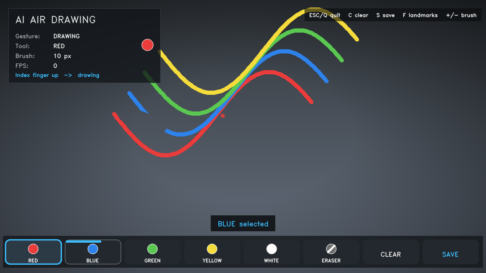

# AI Air Drawing — Hand Gesture Virtual Paint

Draw in the air with your index finger. Your laptop webcam tracks your hand with
MediaPipe, turns the index fingertip into a pen, and paints onto a transparent
virtual canvas that is composited over the live camera feed.

No GPU, no cloud service, no database, no backend — one Python process and your webcam.

```
Webcam -> Hand detection -> 21 landmarks -> Finger tracking -> Gesture detection
       -> Virtual canvas -> Composite over camera -> Save as PNG
```



*The interface: HUD with live gesture/tool/FPS readout, the paint layer over the
camera feed, and the eight-button toolbar with dwell feedback. (Layout rendered
offline — the curves are test strokes, not a camera feed.)*

---

## Features

| # | Feature | Notes |
|---|---------|-------|
| 1 | Live webcam feed | Configurable resolution, mirror mode, explicit error handling |
| 2 | Hand detection | MediaPipe Hands, 21 landmarks, optional skeleton overlay |
| 3 | Index fingertip tracking | Normalised → pixel conversion, clamped to the frame |
| 4 | Geometric gesture detection | No ML model — pure landmark geometry |
| 5 | Continuous air drawing | Points are connected into strokes, never disconnected dots |
| 6 | Virtual toolbar | Red / Blue / Green / Yellow / White / Eraser / Clear / Save |
| 7 | Real eraser | Erases through an alpha mask — it removes paint, it does not paint over it |
| 8 | Clear canvas | Wipes the drawing, camera keeps running |
| 9 | Save as PNG | `drawings/drawing_001.png`, auto-incrementing, transparent background |
| 10 | Polished HUD | Gesture, active tool, brush size, FPS, live hints |
| 11 | Fingertip smoothing | Exponential smoothing, configurable strength |
| 12 | Dwell-to-select | Hold your finger on a button for ~0.6 s — no accidental clicks |
| 13 | Robust error handling | Camera, MediaPipe, empty frames, lost hands, bad coordinates, disk errors |
| 14 | Headless self-test | `python app.py --self-test` verifies everything without a webcam |

---

## Technologies

- **Python 3.11 / 3.12** — MediaPipe has no wheels for 3.13 yet
- **OpenCV** (`opencv-contrib-python`) — capture, rasterising, compositing, GUI window
- **MediaPipe** — hand landmark model (CPU, runs on a normal laptop)
- **NumPy** — canvas buffers

Deliberately **not** used: TensorFlow, PyTorch, any AI API, any web framework, any database.

---

## Requirements

- Python **3.11** or **3.12** (3.13 will fail to install MediaPipe)
- A webcam
- Windows / macOS / Linux, CPU only

---

## Installation

### 1. Get the code

```bash
cd air-drawing
```

### 2. Create a virtual environment

**Windows (PowerShell / CMD)**
```bash
python -m venv .venv
.venv\Scripts\activate
```

**macOS / Linux**
```bash
python3.11 -m venv .venv
source .venv/bin/activate
```

### 3. Install dependencies

```bash
pip install --upgrade pip
pip install -r requirements.txt
```

### 4. Verify the installation (recommended)

```bash
python app.py --self-test
```

This checks the dependencies, the gesture geometry, the canvas, the eraser, the
toolbar, the render path and your webcam — and prints a pass/fail report. If it
says everything passed, you are ready to draw.

---

## How to run

```bash
python app.py
```

A window opens with your mirrored camera feed, the drawing canvas, the toolbar
and the HUD.

### Useful flags

```bash
python app.py --camera 1              # use a different webcam
python app.py --landmarks             # show the 21-point hand skeleton
python app.py --smoothing 0.3         # smoother line (more lag)
python app.py --brush 16 --eraser 60  # thicker brush and eraser
python app.py --width 960 --height 540
python app.py --drawings-dir D:/my-art
python app.py --no-mirror
python app.py --self-test
```

---

## Gesture controls

| Gesture | Landmarks | Action |
|---------|-----------|--------|
| ☝️ **Index finger up** | 8 extended, 12 curled | **Draw** — the fingertip is the pen |
| ✌️ **Index + middle up** | 8 and 12 extended | **Select** — move the pointer over a toolbar button |
| ✊ **Fist** | no finger extended | **Stop** — nothing happens, the stroke ends |
| Hand out of frame | — | Tracking pauses and the stroke is safely ended |

A finger counts as "extended" when its tip is further from the wrist than its
middle joint (PIP). That test keeps working when you rotate your hand, unlike a
naive "tip is above the joint" comparison.

### Selecting a tool

1. Raise index **and** middle finger.
2. Move the crosshair over a button.
3. **Hold** it there for about 0.6 s — the orange bar on the button fills up.
4. The tool activates and the pointer locks out briefly so you don't double-select.

There is no need to touch anything, and no accidental selections from a finger
that merely passes over the toolbar.

---

## Keyboard controls

| Key | Action |
|-----|--------|
| `R` `B` `G` `Y` `W` | Red / Blue / Green / Yellow / White |
| `E` | Eraser |
| `C` | Clear canvas |
| `S` | Save drawing |
| `F` | Toggle the landmark skeleton overlay |
| `+` / `-` | Brush size |
| `ESC` / `Q` | Quit |

The keyboard shortcuts exist so you can work without gestures at all.

---

## Project structure

```
air-drawing/
├── app.py                    # entry point, CLI arguments, --self-test
├── requirements.txt
├── README.md
├── src/
│   ├── config.py             # every tunable constant lives here
│   ├── camera.py             # webcam wrapper, backend fallback, error handling
│   ├── hand_tracker.py       # MediaPipe wrapper, landmark indices, Hand dataclass
│   ├── gesture_detector.py   # is_index_finger_up(), is_fist(), detect_gesture()
│   ├── drawing_canvas.py     # DrawingCanvas (with alpha mask), Toolbar, DrawingStore
│   ├── drawing_app.py        # the main loop, state machine, HUD renderer
│   └── self_test.py          # headless verification
├── drawings/                 # saved PNGs land here (created automatically)
└── assets/                   # free space for icons / fonts if you extend the UI
```

### How a frame flows

1. `Camera.read()` returns a mirrored BGR frame.
2. `HandTracker.process()` returns a `Hand` (21 pixel landmarks) or `None`.
3. `detect_gesture()` maps the landmarks to `DRAW` / `SELECT` / `FIST` / `IDLE`.
4. `Smoother` filters the fingertip jitter.
5. `DrawingCanvas` rasterises the segment (or erases it).
6. `composite()` blends the paint over the camera frame.
7. `Toolbar` and the HUD are drawn on top; the result goes to the window.

---

## Configuration

Everything tunable is in `src/config.py`, or overridable from the command line:

```python
CAMERA_INDEX   = 0        # webcam to open
FRAME_WIDTH    = 1280
FRAME_HEIGHT   = 720
MIRROR_FRAME   = True

BRUSH_SIZE     = 10       # normal pen thickness (px)
ERASER_SIZE    = 40       # eraser is 4x the pen
SMOOTHING_FACTOR = 0.5    # 0.05 = very smooth, 1.0 = raw and jittery

TOOLBAR_DWELL_FRAMES = 18 # ~0.6 s hold to confirm a toolbar selection
SHOW_LANDMARKS = False    # skeleton overlay, also toggled with F
```

---

## Troubleshooting

**`Could not open the webcam at index 0`**
Close Zoom / Teams / the Windows Camera app. Check *Settings → Privacy → Camera*
and allow desktop apps. Then try `python app.py --camera 1`.

**`MediaPipe is not installed` / install fails**
MediaPipe publishes wheels for Python 3.9–3.12 only. Check your version with
`python --version` and recreate the venv with 3.11 or 3.12.

**`The webcam opened but returned no frames`**
The device is claimed by another process. Close it and retry.

**Drawing feels jittery**
Lower the smoothing value: `python app.py --smoothing 0.3`.

**Drawing lags behind my finger**
Raise it: `python app.py --smoothing 0.7`, or drop to
`--width 960 --height 540`.

**The toolbar selects the wrong button**
Your fingertip is hovering between two buttons. Aim at the centre, and remember
the ~0.6 s dwell — passing over a button does not select it.

**Lines appear when my hand comes back into frame**
That should not happen — losing tracking resets the previous point by design. If
you see it, raise `MIN_DRAW_DISTANCE` in `config.py`.

**`[OPENCV ERROR]` when the window opens**
Your OpenCV build has no GUI support. Reinstall with
`pip install --force-reinstall opencv-contrib-python`.

**MediaPipe prints `Feedback manager requires a model with a single signature`**
Harmless. It comes from MediaPipe's internal TFLite runtime and can be ignored.

---

## Future improvements

Not implemented — the core app is finished first. Each of these is a natural
next step on top of the existing structure:

- **Two-hand tracking** — `max_num_hands=2`, second hand for colour switching
- **Gesture-controlled mouse** — map the fingertip to OS cursor events
- **Virtual keyboard** — a second toolbar layout with letters
- **Volume / brightness control** — pinch distance → system level
- **Presentation control** — swipe gestures to advance slides
- **ML gesture classifier** — replace the geometry with a trained model
- **3D hand interaction** — use the `z` landmark channel for depth
- **Drawing recognition** — classify what you drew (digit / shape)
- **Voice commands** — "clear", "save", "undo"

A few smaller quality-of-life ideas: undo/redo with a stroke stack, shape
snapping (hold still to straighten a line), per-stroke layers, and exporting an
MP4 timelapse of the session.

---

## License

Use it, modify it, ship it. No warranty.
